# game-toolkit-dosvideo

DOS-era PC video for [game-toolkit](https://github.com/sunsided/game-toolkit): VGA (mode 13h,
Mode X, 16-color planar, text), EGA, CGA (with composite artifact colors and snow), Hercules,
Tandy 1000 and VESA SVGA, emulated at the register level with a beam-accurate CRT.

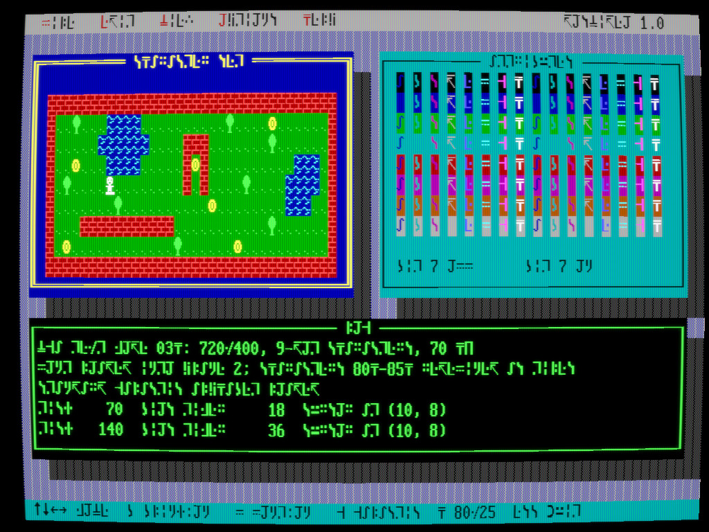

*`text_mode` with the Standard Galactic Alphabet loaded into the character generator (`G`) and the VGA
monitor CRT filter (`Alt+C`).*

It is not a PC emulator: your game is ordinary Rust. What is emulated is the part DOS
programmers fought with, the display adapter: its memory layout, its registers, its timing,
and the electron beam that reads it out while you are writing to it. Program it through I/O
ports and memory pokes like in 1992, or through the helpers that do the same thing with less
typing.

```rust
use game_toolkit_dosvideo::prelude::*;

struct Hello;

impl DosGame for Hello {
    fn init(dos: &mut Dos) -> anyhow::Result<Self> {
        dos.set_mode(0x13); // INT 10h, AX=0013h
        Ok(Self)
    }

    fn step(&mut self, dos: &mut Dos) {
        // while (inp(0x3DA) & 8); while (!(inp(0x3DA) & 8));
        dos.wait_vretrace();
        dos.set_palette(1, [63, 0, 0]); // OUT 3C8h / 3C9h
        dos.fill(0xA0000 + 100 * 320, 320, 1); // a red line in A000:7D00
        if dos.key(sc::ESC) {
            dos.exit();
        }
    }
}

fn main() -> anyhow::Result<()> {
    run::<Hello>(DosConfig::new("hello", Adapter::Vga))
}
```

## The model: a clock, a bus and a beam

A `Dos` is a machine with a clock. Everything costs time:

- port I/O (`outb`, `inb`) and video memory access (`poke`, `peek`, `poke_slice`, `fill`),
  priced by the configured `BusTiming`. An 8-bit ISA card moves about 1 MB/s, a 16-bit ISA VGA
  2–4 MB/s, a VLB or PCI card 30–60 MB/s.
- CPU work you choose to charge (`dos.cpu(cycles)` at the configured clock rate).
- waiting for the beam: `wait_vretrace`, `wait_vblank`, `wait_line(n)`, `wait_hblank`,
  `wait_beam(line, dot)`, or polling the status port yourself.

The CRT paints the picture as the beam sweeps, dot by dot, from the adapter's state *at that
moment*. Nothing is special-cased, so the tricks of the era just work:

- copper bars: DAC writes between scanlines (at 400-line resolution in mode 13h, into the
  overscan border too).
- palette cycling and fades.
- page flipping with the start address, which latches at vertical retrace, like the real CRTC.
- split screens with line compare, smooth scrolling with pel panning, virtual screens with the
  offset register.
- tweaked modes (Mode X, 320x400, 360x240, …): timing and resolution are derived from the
  CRTC registers, so programming them is enough.
- latch copies (write mode 1) for four planes per byte, set/reset and the bit mask, and read
  mode 1 color compare.

So do the failure modes:

- tearing when a copy is overtaken by the beam (on a slow bus a full mode 13h frame takes
  longer than the vertical blank).
- the attribute controller flip-flop, and a blank screen if the palette address source bit
  isn't set again.
- CRTC registers 0–7 being write-protected.
- leftover garbage after unchaining mode 13h.
- CGA snow in 80-column text.
- the inverted Hercules retrace bit.
- EGA's write-only registers and the 16-color limit of its 200-line modes.
- the mouse driver reporting 640x200 coordinates in mode 13h.

## Adapters

| `Adapter` | Memory | BIOS modes | Highlights |
|-----------|--------|-----------|------------|
| `Vga` | 256 KiB, 4 planes | 00h–03h, 0Dh, 0Eh, 10h, 12h, 13h | Mode X (`ModeX`), DAC, line compare, pel panning, chain-4 / odd-even / planar addressing, 9-dot text with fonts in plane 2 |
| `Ega` | 256 KiB, 4 planes | 02h, 03h, 0Dh, 0Eh, 10h | write-only registers, 64-color palette (RGBI in 200-line modes), 14.318/16.257 MHz clocks |
| `Cga(CgaMonitor)` | 16 KiB | 00h–06h | 2 palettes + intensity, mode 5, 640x200, composite artifact colors, snow, 160x100 via 6845 tweaks |
| `Tandy` | 32 KiB | 00h–06h, 08h, 09h, 0Ah | 160x200x16, 320x200x16, 640x200x4, video gate array palette |
| `Hercules(Phosphor)` | 64 KiB, 2 pages | 07h (+ `hercules_graphics`) | 720x348, 4-way interleave, config switch, MDA attributes, 9th-column line graphics |
| `Svga { memory_kib }` | as configured | VGA modes + VBE 100h–118h | 64 KiB bank window with switch cost, linear framebuffer at `0xE0000000`, display start, scanline length, 8-bit DAC, 8/15/16/32 bpp |

SVGA is period-correct for DOS: VBE 1.2 (1991) and 2.0 (1994) were how DOS games reached
640x480 and above.

## Layers of API

From most to least authentic, freely mixed:

1. **Ports and memory**: `outb`, `outw`, `inb`, `poke`, `peek`, `pokew`, `poke32`,
   `poke_slice`, `fill`, `copy_vram`, at physical addresses (`0xA0000`, `0xB8000`, …).
2. **BIOS**: `set_mode` (`INT 10h`), `vbe_set_mode`, `vbe_set_bank`,
   `vbe_set_display_start`, `bios_print` (teletype with scrolling), `load_font`, `getch` /
   `kbhit` (`INT 16h`), `mouse()` (`INT 33h`), `set_timer_hz` / `take_timer_ticks` (the PIT),
   `exit` (`INT 21h, 4Ch`).
3. **Register helpers**: `set_palette`, `cycle_palette`, `fade_palette`, `seq`, `gc`, `crtc`,
   `attr`, `map_mask`, `write_mode`, `bit_mask`, `set_start_address`, `set_offset`,
   `set_line_compare`, `set_pel_pan`, `set_border`, `screen_on`.
4. **Drawing**: `pset` (any graphics mode, in that mode's memory layout), `pset13`, `blit13`,
   `planar_pset`, `planar_fill_rect`, `planar_blit`, `cga_blit`, `tandy_blit`, `herc_pset`,
   `vbe_pset_banked`, `vbe_pset_lfb`, `vbe_write_banked`, `ModeX` (set, pset, fill_rect, blit,
   VRAM-to-VRAM latch copy, flip), text helpers (`text_print`, `text_box`, `set_cursor`,
   `set_blink`, …).
5. **`Bitmap`**: an 8-bit back buffer in system memory with lines, rects, circles, blits and
   bitmap-font text, for double buffering the way most games did.

Keyboard input comes both ways: `dos.key(sc::LEFT)` is the held-key table a custom `INT 9`
handler would fill, and `getch()` / `kbhit()` is the BIOS buffer.

## Looking like a CRT

Pixel-sharp output is the default. `DosConfig::with_crt(CrtFilter::tv())` (or `Alt+C` at run
time, cycling off → crisp scanlines → soft glow → VGA monitor → TV → green screen → amber screen)
adds a GPU
post-filter.
The emulated frame has one row per *real* scanline (400 in mode 13h, 200 on a CGA, 350 on a
Hercules card), so the filter can model the beam instead of faking it:

- **scanlines**: each line is a horizontal stripe of light whose height grows with
  brightness, so gaps show between dark lines and close between bright ones. 15 kHz modes get
  visible gaps, 31 kHz VGA gets fine ones.
- **beam blur**: the horizontal spread of the electron spot. This is what melted dither
  patterns into the in-between colors the artists of the era counted on.
- **phosphor mask** (aperture grille, slot mask or shadow mask): light is split into R, G and B
  stripes or dots on the window's own pixels, the "subpixel" structure the eye fuses back
  together. It needs about 3 window pixels per triad and fades out below that.
- **bloom**, **curvature**, **vignette**, rounded corners.
- **soft glow** keeps the colors but uses a monochrome monitor's optics (no mask, soft beam,
  glowing phosphor): not historical, but easy on the eyes.
- **monochrome**: the green and amber screen presets show only brightness in the phosphor's
  color, like a color card on a cheap monochrome monitor.

Every knob is a field of `CrtFilter`. With `DosScreen` in your own game, set `screen.crt` and
call `screen.draw_crt(&ctx.gfx, frame)` after the painter for the frame is dropped.

## Dithering and fonts

`Bitmap::from_rgba(w, h, rgba, palette, Dither::Bayer4)` turns true-color art into palette
indices the period way: nearest color, ordered Bayer 2x2 / 4x4 / 8x8, or Floyd-Steinberg error
diffusion.

Fonts: `Font::vga()` (8x16), `Font::ega()` (8x14), `Font::cga()` (8x8), and the Standard
Galactic Alphabet of the Commander Keen games as `Font::sga()`, `Font::sga_ega()` and
`Font::sga_cga()`: letters become Standard Galactic Alphabet glyphs, everything else stays
CP437. Load any of them into
text mode with `dos.load_font(font, 0)`, or draw with `Bitmap::text`.

## The PC speaker

PIT channel 2 and port `0x61` are emulated on the machine clock, and the speaker output is
rendered by integrating the cone position over every audio sample, then played through
game-toolkit's audio (or written to a WAV in headless runs: `DOSVIDEO_WAV=out.wav`).

- `dos.sound(hz)` / `dos.nosound()`: Turbo Pascal style, or program the ports yourself
  (`OUT 43h,B6h`, the divisor to `42h`, bits 0+1 of `61h`). Port `61h` bit 4 toggles every
  15 µs like the DRAM refresh that delay loops counted.
- `Melody::new("T140 O3 L4 EEFG GFED ...")`: QBasic `PLAY` strings, in the background.
- `dos.speaker_pwm(&samples, 11_025)`: digitized sound by bit-banging the speaker. It blocks
  for the length of the sound, as it did.
- With the `synth` feature, `speaker_synth::SpeakerTracker` plays a
  [synthie](https://docs.rs/synthie) song (the tracker format of game-toolkit's chiptune synth)
  on the speaker: chords and arpeggio cells become one-note-per-frame arpeggios, drums become
  pitch sweeps and noise bursts.

## Running

`run::<G>(DosConfig)` opens a game-toolkit window. `DosGame::step` is one iteration of your
main loop; the host calls it as often as emulated time allows, so a loop that waits for the
retrace once runs at the mode's refresh rate (70 Hz in mode 13h, 60 Hz in Mode X, ~50 Hz on a
Hercules card). Alt+Enter toggles fullscreen, Alt+C cycles the CRT filter. `DosConfig::with_keys(&[("B", "bars on/off"), ...])`
documents your program's keys; `run` prints them to stdout at startup, with the host keys. `DosConfig` picks the aspect (`Aspect::Crt` by
default, so the active area is 4:3 and mode 13h pixels are taller than wide), the overscan
border, integer scaling and the CRT filter.

To put a DOS screen into your own `Game`, use `DosScreen` directly: `feed_input`, then step
your `Dos`, `upload` and `draw`.

Headless, for tests and screenshots: `DOSVIDEO_SHOT=out.png DOSVIDEO_SHOT_FRAMES=120
cargo run --example copper_bars` writes the frame as PNG instead of opening a window, and
`DOSVIDEO_KEYS=30:0x30,90:0x24` taps keys (by scancode) at given frames (also in window mode, counted in host frames). Those shots are the
raw emulated frame; to capture the window with the CRT filter, use
`DOSVIDEO_WINDOW_SHOT=out.png DOSVIDEO_WINDOW_SHOT_FRAMES=90`, and `DOSVIDEO_CRT=0..6` to pick
a preset. `dos.frame()`
gives the last complete frame as RGBA anywhere, with `to_png()`.

Features: `toolkit` (default) for the game-toolkit host, `synth` for tracker music on the PC
speaker. Without the default `toolkit` feature the crate has no dependencies at all: just the machine,
for tests or for driving it from another frontend.

## Gallery

Captured from the running demos (`DOSVIDEO_WINDOW_SHOT`), some through a CRT preset.

| | |
|---|---|
| 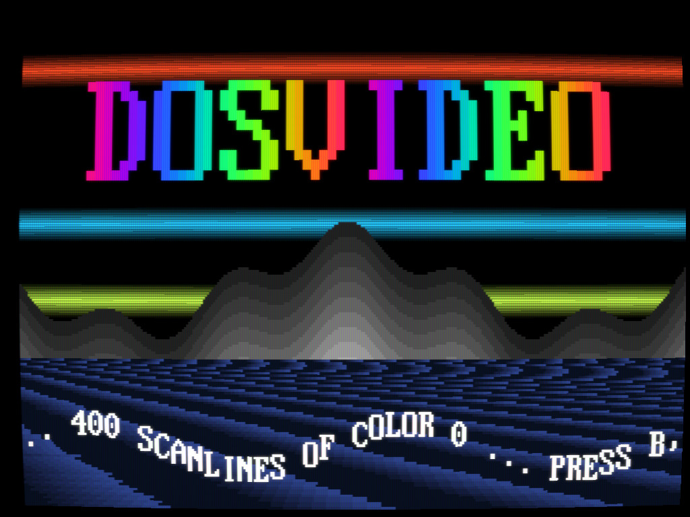 | 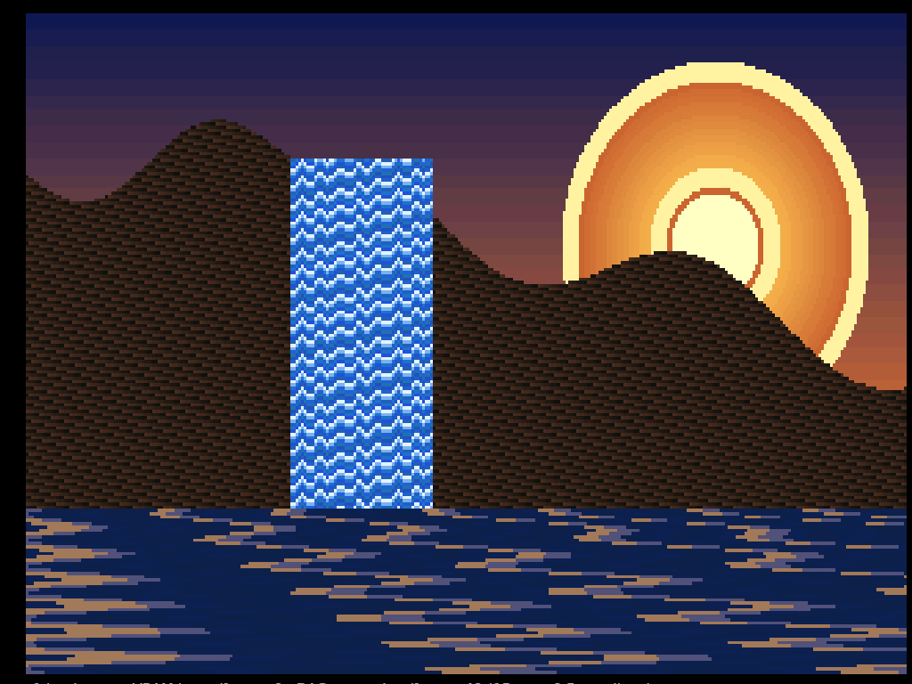 |
| **`copper_bars`**: raster bars by rewriting one DAC entry per scanline (VGA monitor filter) | **`palette_cycling`**: water, ripples and sun glow move without touching a pixel |
| 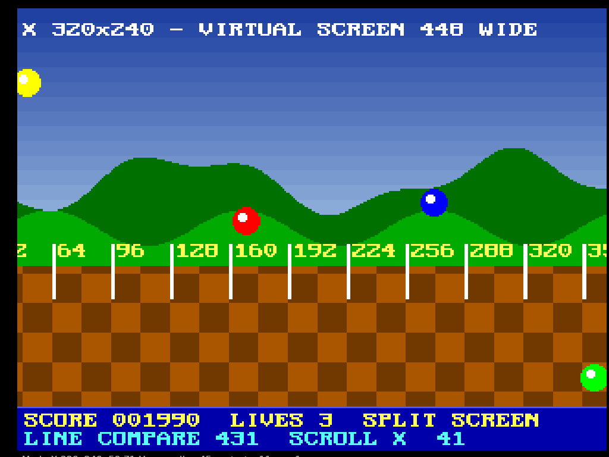 | 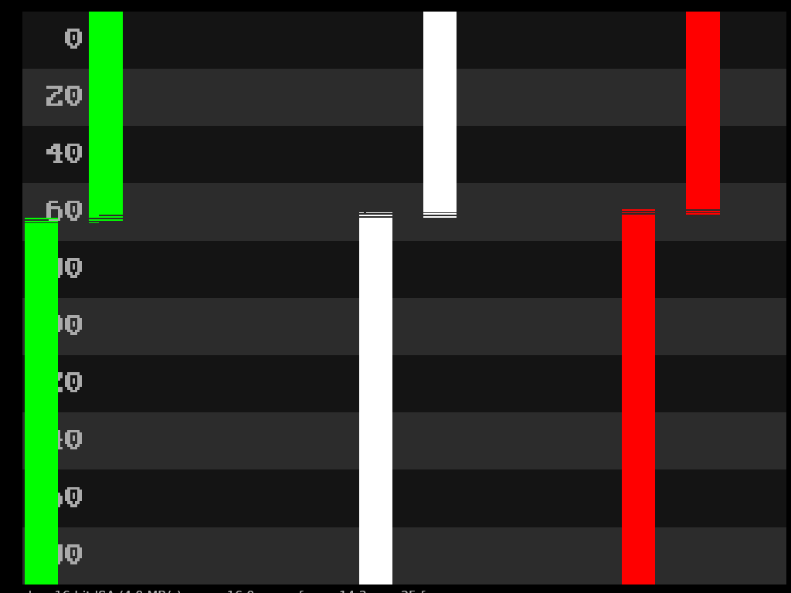 |
| **`modex_scroll`**: Mode X 320x240, hardware scrolling, split-screen status bar, page flipping | **`tearing_lab`**: a full-frame copy on a 16-bit ISA bus, overtaken by the beam |
| 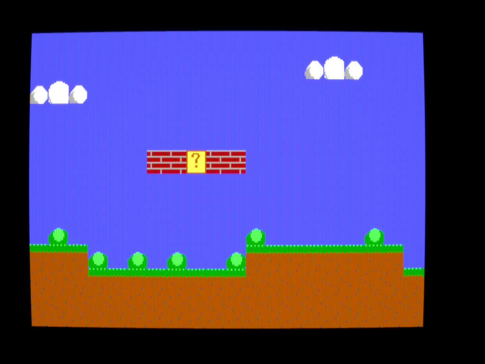 | 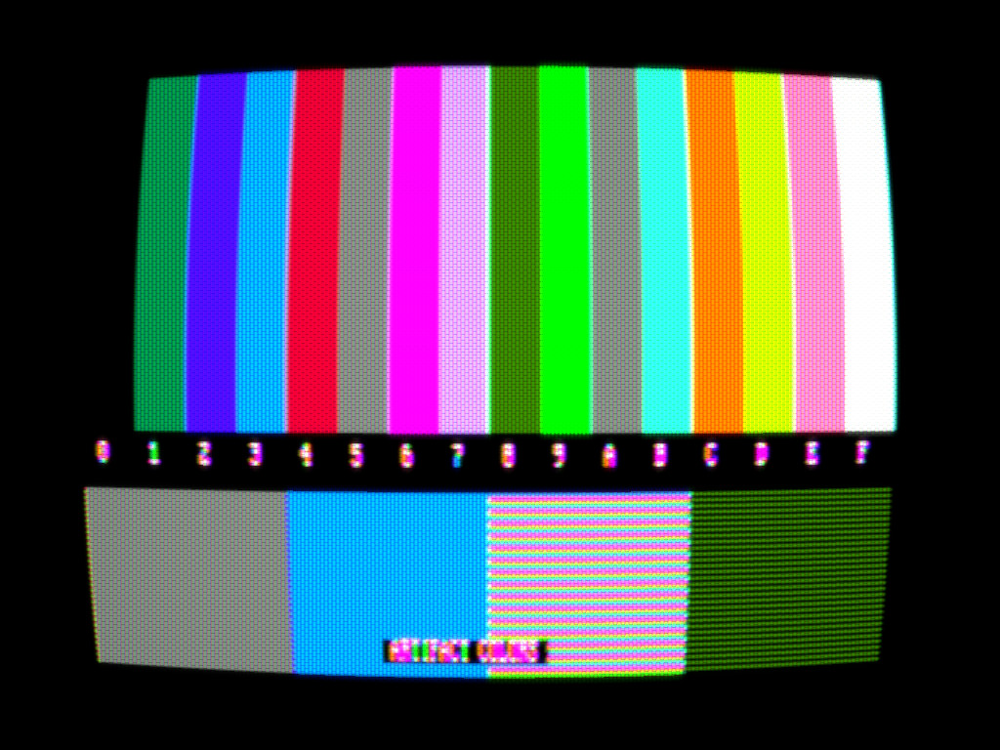 |
| **`ega_scroller`**: smooth scrolling with pel panning and latch tile copies (VGA monitor filter) | **`cga_showcase`**: 640x200 black-and-white patterns turned into composite artifact colors (TV filter) |
| 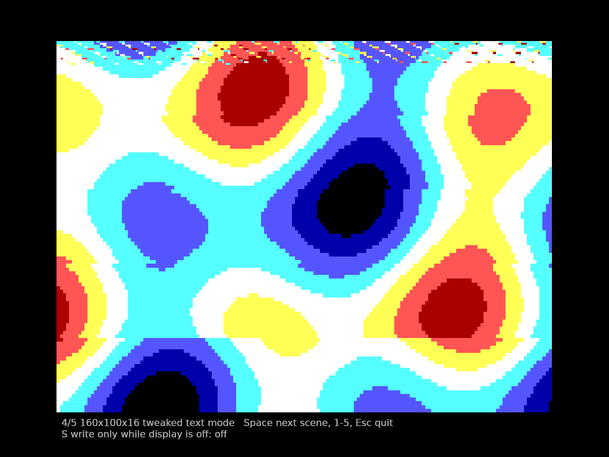 | 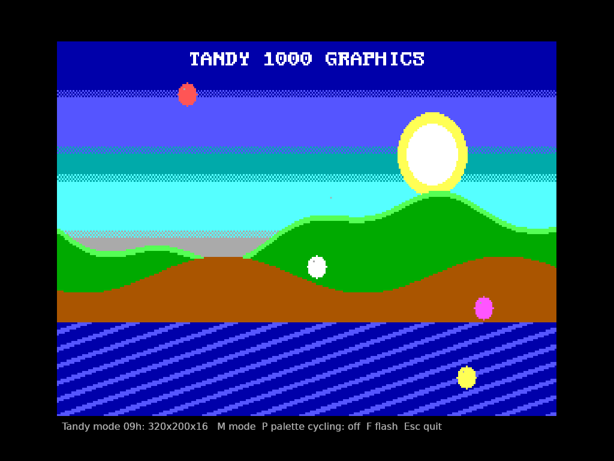 |
| **`cga_showcase`**: 16 colors on a CGA via the 160x100 tweaked text mode | **`tandy`**: Tandy 1000 320x200 in 16 colors |
| 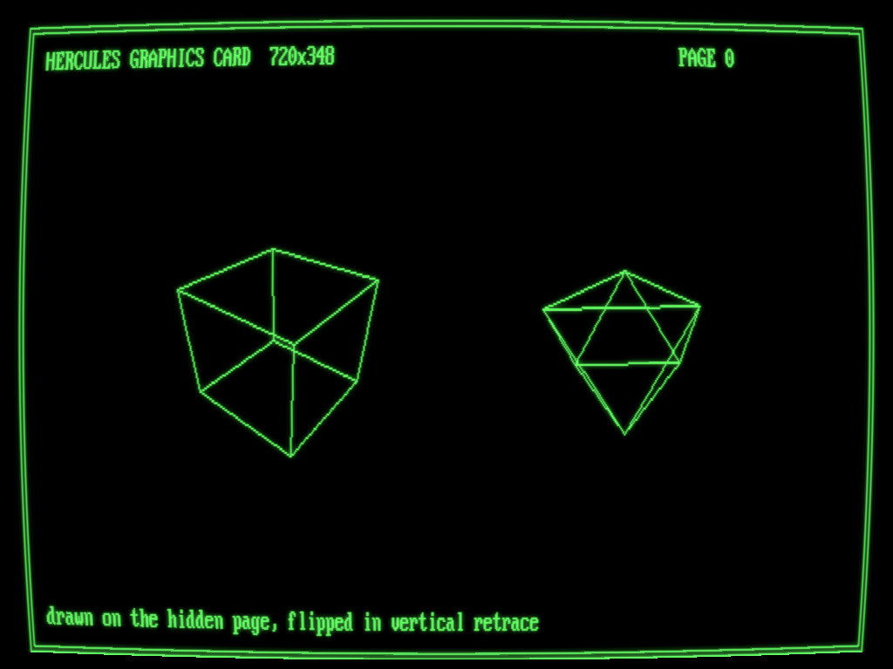 | 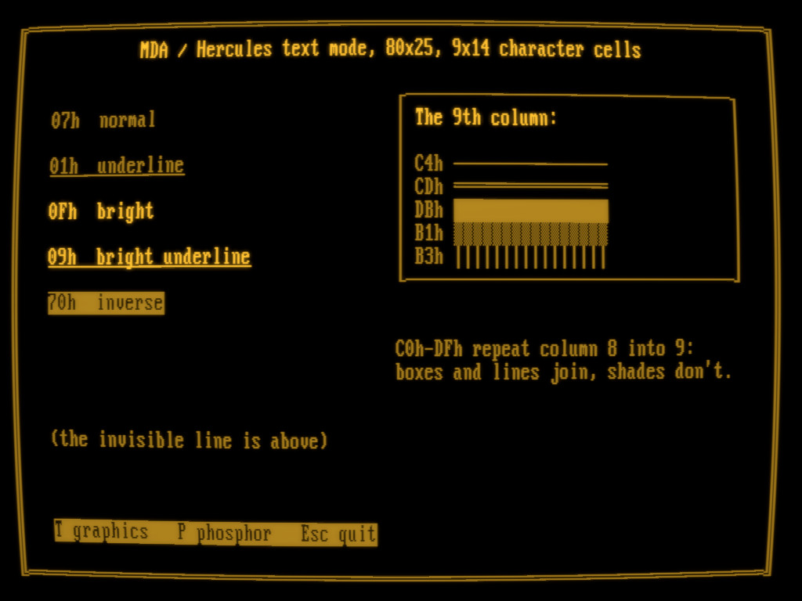 |
| **`hercules`**: 720x348, drawn on the hidden page and flipped in vertical retrace (green screen filter) | **`hercules`**: MDA text attributes and the 9th-column rule (amber screen filter) |
| 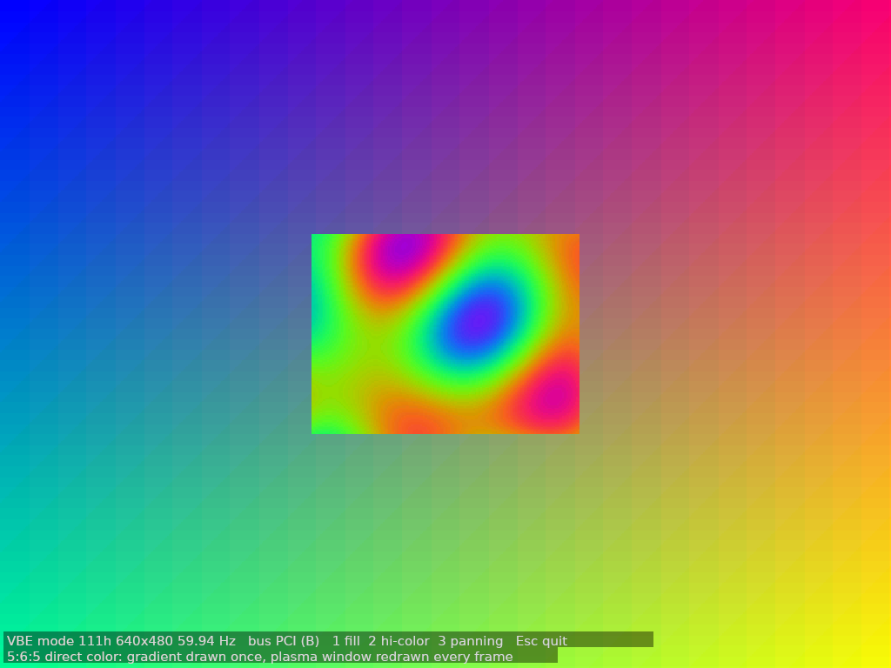 | 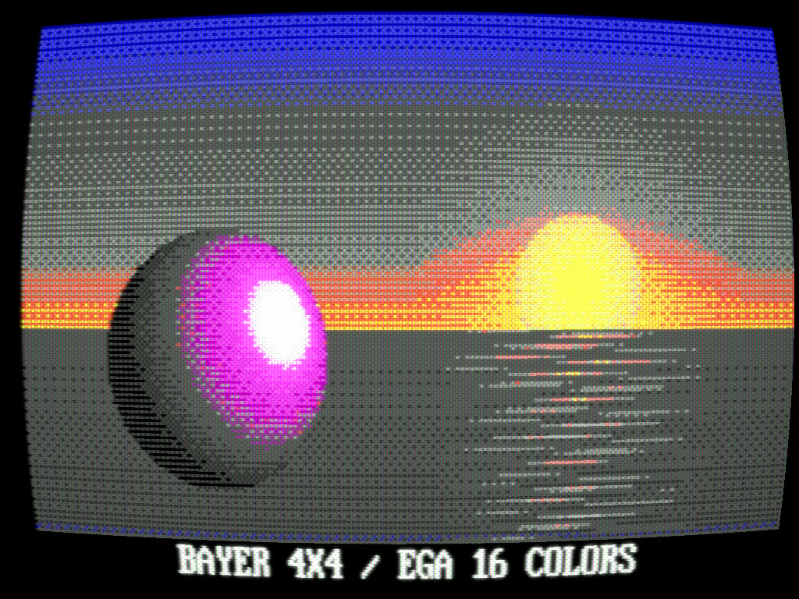 |
| **`svga`**: VBE 640x480 in 65536 colors | **`crt_dither`**: Bayer dithering to 16 colors, melted by the TV filter |
| 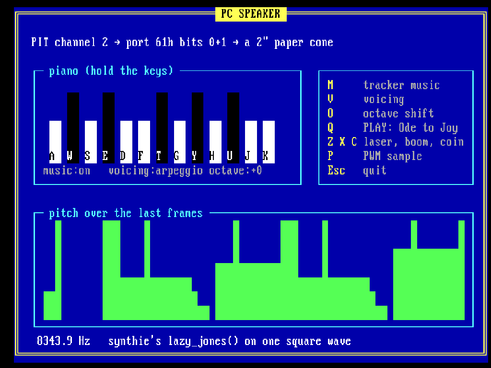 |  |
| **`pc_speaker`**: piano, synthie tracker music on one square wave, PWM samples | **`text_mode`**: tile graphics and the Standard Galactic Alphabet in the character generator |

## Demos

```sh
task examples            # list them
task run EXAMPLE=copper_bars
task shots               # screenshot every demo headless into target/shots/
```

| Demo | Shows |
|------|-------|
| `copper_bars` | Mode 13h raster bars at 400-scanline resolution (DAC entry 0 rewritten each line), palette cycling, a sine scroller. `T` cycles the raster loop: proper (write in the previous line's hblank), naive (write at line start: a lagging stripe on the left) and jittery (frayed edges). `O` lets the bars run into the overscan border. |
| `palette_cycling` | Animation by palette rotation alone: a landscape with flowing water, lake ripples and a pulsing sun; a plasma; fades and flashes; and on an ISA8 bus, the seam left when DAC writes happen mid-frame (`T`). The overlay counts VRAM bytes per frame: 0. |
| `modex_scroll` | Mode X 320x240: a 448-pixel-wide virtual screen with smooth scrolling (start address + pel panning), a split-screen status bar via line compare, and page-flipped sprites. `T` draws without flipping, `R` shows why pel-panning reset below the split matters. |
| `tearing_lab` | A full mode 13h copy every frame. `1`-`5` pick the bus (ISA8 to PCI), `S` picks no wait / vsync / racing the beam. Shows why ISA tears and local bus doesn't. |
| `ega_scroller` | EGA mode 0Dh side-scroller: virtual screen via the offset register, per-pixel scrolling, tiles copied with latches (write mode 1), day/night via the attribute palette. `J` shows the jitter from setting pan and start in the wrong order. |
| `cga_showcase` | Five scenes: mode 4 palettes, intensity and background; mode 5; mode 6 patterns on RGB vs. composite (artifact colors, hue knob); the 160x100x16 tweak; 80-column snow and the retrace-wait cure. |
| `tandy` | Mode 9 320x200x16 with dirty-row updates in the 4-bank interleave, gate-array palette effects, and modes 8 and 0Ah. |
| `hercules` | 720x348 wireframes with two-page flipping on the inverted retrace bit, phosphor colors, and MDA text attributes with the 9th-column rule. |
| `svga` | VBE 640x480x8 fill benchmark (banked by pixel, column or row vs. LFB, with bank-switch counts), 640x480 hi-color, and 800x600 panning over a 1600x1200 virtual screen. |
| `crt_dither` | A true-color scene reduced to EGA, CGA or 256 colors with each dither method, shown through the CRT presets (`Alt+C`) that blend the patterns. `G` switches the captions to the Standard Galactic Alphabet. |
| `pc_speaker` | The PC speaker: a piano on the keyboard, synthie's `lazy_jones()` reduced to one square wave (`M`, voicings `V`), a QBasic `PLAY` tune (`Q`), frame-rate sound effects and PWM sample playback that freezes the screen (`P`). Needs the `synth` feature. |
| `text_mode` | An 80x25 TUI: boxes and shadows, blink vs. bright backgrounds, cursor, a custom tile character set loaded into plane 2 (with animated water), the Standard Galactic Alphabet (`G`), and 80x50. |

## Accuracy

The goal is "feels like the hardware, behaves like the hardware where a program can tell", not
cycle accuracy. Simplifications worth knowing:

- Memory writes become visible to the beam immediately; the CRTC's character-clock prefetch
  is not modeled.
- 6845 boards (CGA, Tandy, Hercules) have no blanking registers, so their border width is an
  approximation.
- CGA composite output is a straightforward NTSC encode/decode of RGBI colors, not a model of
  the CGA's chroma circuitry; tune it with `cga_set_composite_hue`.
- EGA and VGA 8-bit mode pass both nibbles through the attribute palette, as the hardware
  does; per-card quirks of SVGA chipsets are not modeled (it is a generic VBE 2.0 card).
- There is no interrupt-driven code: instead of a timer ISR, count ticks with
  `take_timer_ticks()`, and instead of raster IRQs, wait for the beam.

## Tasks

`task` (go-task, `Taskfile.dist.yaml`) wraps the usual: `build`, `run`, `test`, `lint`,
`check` (fmt, clippy with and without `toolkit`, wasm32), `ci`, `docs`, `shots`, `font`.

## License

EUPL-1.2. The 8x16 font in `crates/dosvideo/fonts/` is derived from `u_vga16.bdf` by Dmitry
Bolkhovityanov (MIT, see `fonts/LICENSE-vga16.txt`); the 26 glyphs it lacks were drawn for
this project.
